<p align="center">
<picture>
  <source media="(prefers-color-scheme: light)" srcset=".github/assets/banner-light.svg">
  
</picture>
</p>

<p align="center">
  <i>Can a student team rebuild an open hardware security key from its public sources, make it work, and understand what it takes to trust it?</i><br>
  We reproduced the <a href="https://tillitis.se">Tillitis TKey</a>: a 2-layer, hand-solderable redesign of its PCB, assembled in the lab and brought up until it behaved like a standard TKey.
</p>

<p align="center"><sub>Student project at my engineering school's LabCyber, team of six, November 2025 to April 2026 (<a href="https://ptcc.fr/lab-cyber/les-projets-du-labcyber/reproduction-dune-cle-dauthentification-open-hardware/">project page on the LabCyber site</a>). The project <a href="https://ptcc.fr/lab-cyber/les-projets-du-labcyber/projets-etudiants-au-labcyber/">continues at the LabCyber in 2026-2027</a>.</sub></p>

<p align="center">
<picture>
  <source media="(prefers-color-scheme: light)" srcset=".github/assets/divider-light.svg">
  
</picture>
</p>

<p align="center">
<picture>
  <source media="(prefers-color-scheme: light)" srcset=".github/assets/stats-light.svg">
  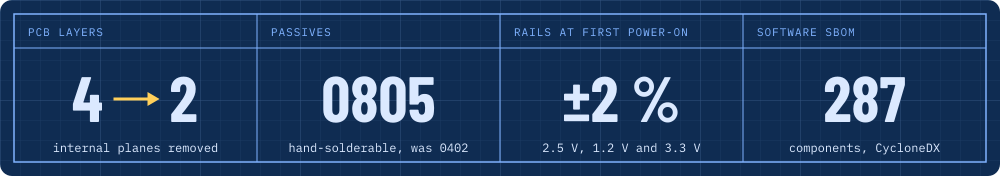
</picture>
</p>

<h3>
<picture>
  <source media="(prefers-color-scheme: light)" srcset=".github/assets/h-why-this-project-light.svg">
  
</picture>
</h3>

Most hardware security keys are closed: their schematics, firmware and key storage cannot be inspected, so users have to trust the vendor. The TKey takes the opposite approach. Its hardware (a Lattice iCE40UP5K FPGA running a small RISC-V core, plus a CH552 USB controller) and its firmware are fully open, which makes it a good subject for a reproduction and hardening project:

- **reproduce** a real security device from its open sources, with the tools and constraints of a school lab;
- **understand** how it generates and protects its secrets;
- **propose** ways to strengthen it, and document everything as reusable material for the LabCyber.

**My part**, with one teammate: the custom PCB route, from the KiCad redesign to the order, the assembly and the bring-up of the board. The other members worked on the reference key, the Voltera prototype, the security analysis and the project management.

<h3>
<picture>
  <source media="(prefers-color-scheme: light)" srcset=".github/assets/h-three-routes-to-a-tkey-light.svg">
  
</picture>
</h3>

<p align="center">
<picture>
  <source media="(prefers-color-scheme: light)" srcset=".github/assets/journey-light.svg">
  
</picture>
</p>

| Route | What it is | Outcome |
|-------|-----------|---------|
| Reference key | a pre-assembled TKey Unlocked from Tillitis, provisioned by us | provisioned and used for signing, SSH and login MFA |
| Custom PCB | our 2-layer redesign, ordered from a PCB maker, assembled in the lab | assembled, powered and brought up until it behaved like a standard TKey |
| Voltera V-One | the same design printed in house with conductive ink | traces printed, assembly stopped (wrong consumables) |

<h3>
<picture>
  <source media="(prefers-color-scheme: light)" srcset=".github/assets/h-the-reference-tkey-light.svg">
  
</picture>
</h3>

The TKey Unlocked ships with a blank FPGA: no bitstream, no Unique Device Secret (UDS). We provisioned it ourselves from the `TK1-24.03` release of [tillitis-key1](https://github.com/tillitis/tillitis-key1):

1. **secrets**: the Tillitis provisioning tool derives the UDS from user entropy and 256 random bytes (HKDF);
2. **bitstream**: Yosys (synthesis), nextpnr-ice40 (place and route), the RISC-V cross-compiler for the firmware, icepack, about 102 KB in the end;
3. **flashing**: `tillitis-iceprog` through the TP-1 programmer, read back with `VERIFY OK`, then the UDS files were deleted from disk.

The provisioned key was then used for three things:

- **file signing** with `tkey-sign` (Ed25519), the key waiting for a physical touch before signing;
- **SSH** with `tkey-ssh-agent`, from Windows and Linux, no password, impossible once the key is unplugged;
- **two-factor login** on a Linux desktop: PAM asks for the password and a TKey challenge-response at the LightDM greeter.

<p align="center">
  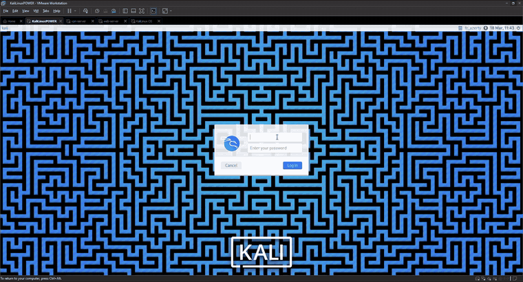
</p>

<h3>
<picture>
  <source media="(prefers-color-scheme: light)" srcset=".github/assets/h-redesigning-the-pcb-light.svg">
  
</picture>
</h3>

The original TKey is a tiny 4-layer board with 0402 parts. We redesigned it in KiCad 9 for what a school lab can build and solder by hand.

<p align="center">
  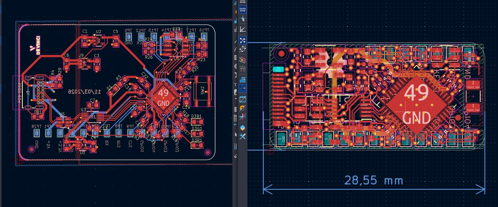
</p>

| | Original TK1 | Our version |
|---|---|---|
| Layers | 4 | 2 |
| Board | USB stick | 57.6 x 39.8 mm card |
| Passives | 0402 / 0603 | 0805 |
| SPI flash | W25Q80 (USON-8) | SST25VF080B (SOIC-8) |
| USB connector | USB-A plug | USB-C receptacle (GCT USB4085) |
| Status LED | one RGB LED | three discrete 0805 LEDs |
| User input | capacitive touch sensor | push button on the same `TOUCH_EVENT` signal |
| Flash `WP#` / `HOLD#` | tied to fixed levels | routed to spare FPGA pins, so firmware can control write protection |
| Regulators | parts no longer available | NCP752 (3.3 V), MCP1824 (2.5 V), NCV8164 (1.2 V) |

<p align="center">
  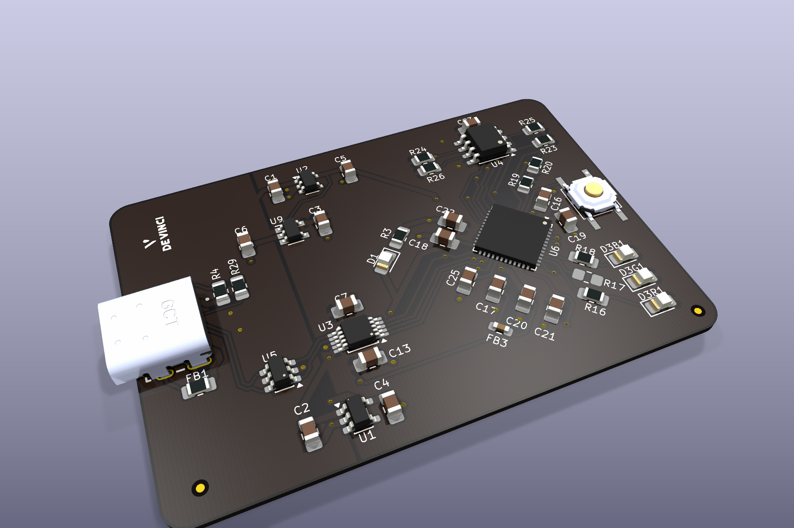
</p>

Going from 4 to 2 layers removes the internal ground and power planes, so we had to work around it:

- copper ground pours on both layers, stitched with vias, to rebuild an approximate ground plane;
- decoupling capacitors as close as possible to every power pin, especially around the FPGA and the CH552;
- the USB D+ / D- pair kept short, tightly coupled and surrounded by ground, since a true 90 Ω impedance is hard to guarantee without a reference plane.

<table>
  <tr>
    <td>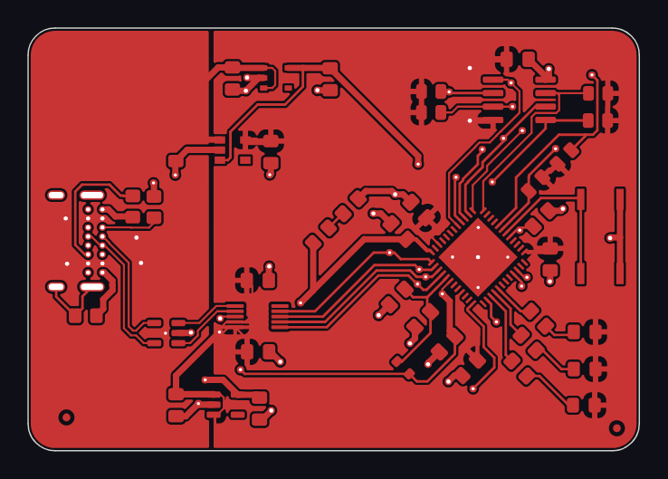</td>
    <td>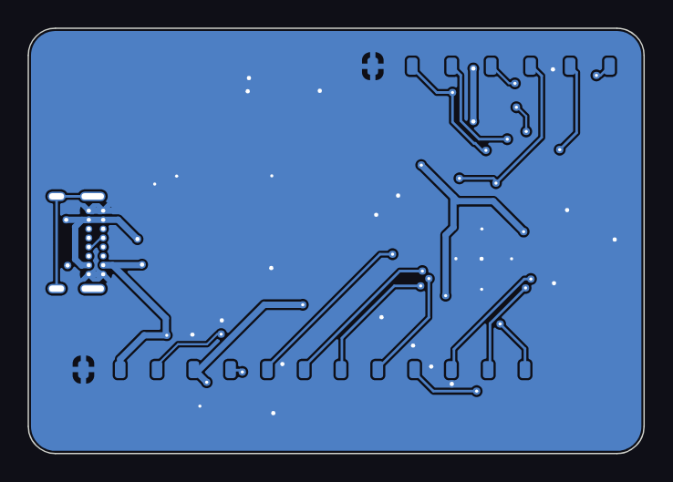</td>
  </tr>
  <tr>
    <td align="center"><sub>front copper</sub></td>
    <td align="center"><sub>back copper</sub></td>
  </tr>
</table>

The 20 test points of the original are kept on the back (SPI, UART, GPIO and every supply rail), which is what made the bring-up possible.

<p align="center">
  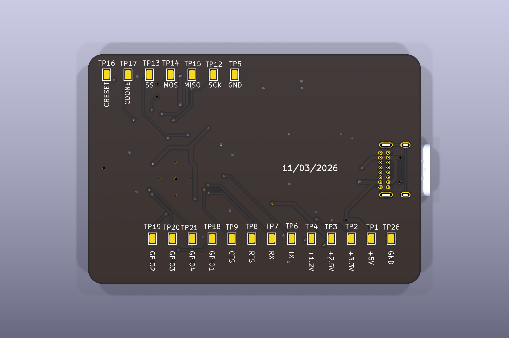
</p>

The full bill of materials is in [`hardware/tk1-2layer/bom.csv`](hardware/tk1-2layer/bom.csv) and the schematic in [`docs/schematic-2layer.pdf`](docs/schematic-2layer.pdf).

<h3>
<picture>
  <source media="(prefers-color-scheme: light)" srcset=".github/assets/h-assembly-and-bring-up-light.svg">
  
</picture>
</h3>

The boards were made by an external PCB maker (2-layer FR4, 1.6 mm) and assembled in the lab: stencil and lead-free solder paste, pick-and-place for the passives, reflow oven, then inspection under the microscope. Two LEDs had been placed backwards and one CH552 pad lacked solder: all three were reworked by hand.

<table>
  <tr>
    <td width="33%">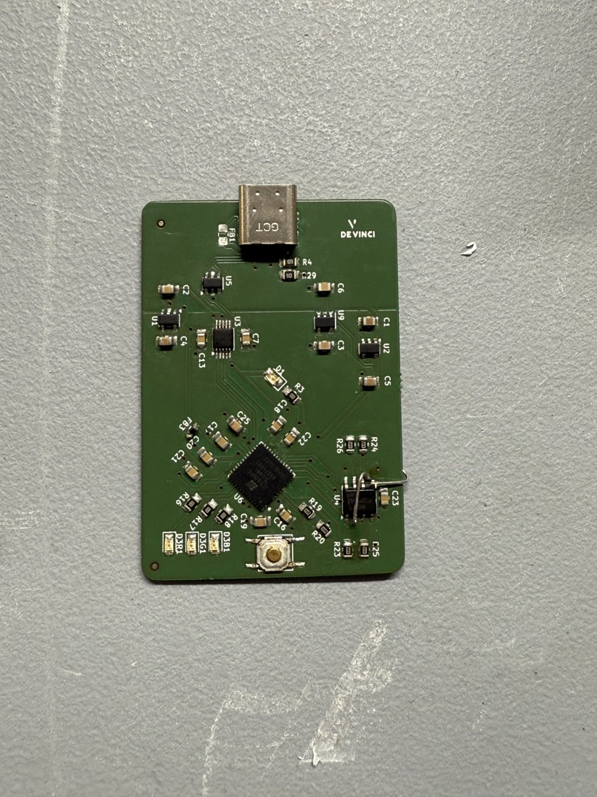</td>
    <td width="33%">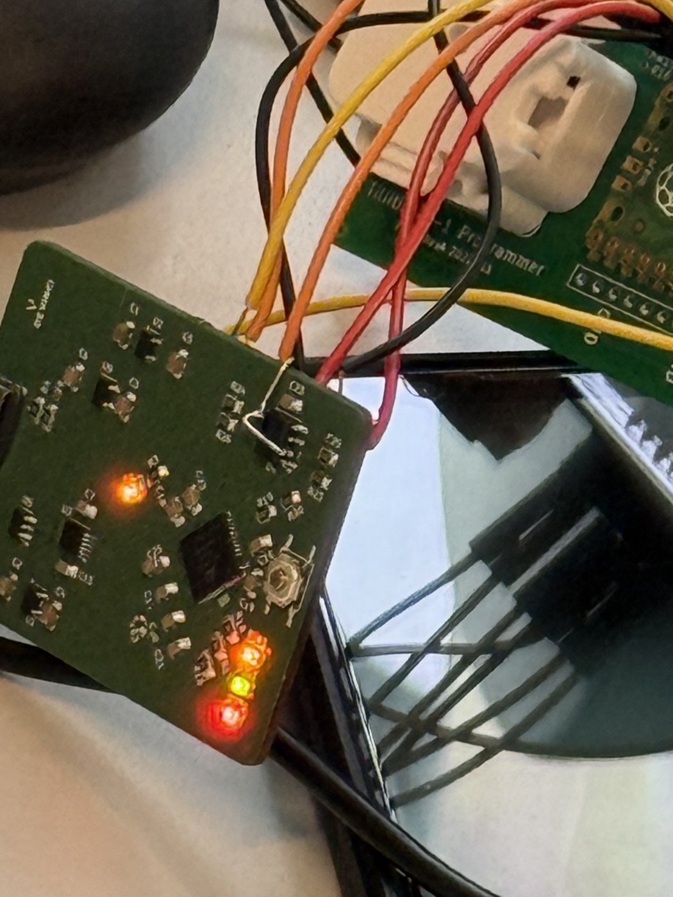</td>
    <td width="33%">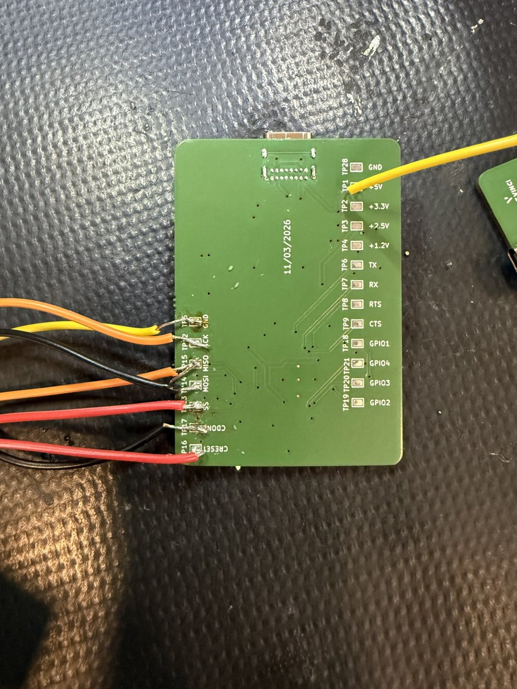</td>
  </tr>
  <tr>
    <td align="center"><sub>assembled</sub></td>
    <td align="center"><sub>powered</sub></td>
    <td align="center"><sub>wired to the test points</sub></td>
  </tr>
</table>

**First power-on**, through a current-limited supply (100 mA): the 2.5 V, 1.2 V and 3.3 V rails were all within ±2 % of their targets, with about 15 mA drawn at idle and no short.

**Bring-up** was the hardest part. The board enumerated on Linux as `/dev/ttyACM0`, but `tkey-sign` failed with `GetAppNameVersion: ReadFrame: Read timeout`.

<p align="center">
<picture>
  <source media="(prefers-color-scheme: light)" srcset=".github/assets/bringup-light.svg">
  
</picture>
</p>

- Reflashing the official FPGA image through the TP-1 passed verification but did not change anything.
- The fix was on the **CH552 USB controller**: we rebuilt its firmware with `sdcc`, flashed it with `chprog`, and entered its bootloader by hand with a 10 kΩ pull-up on D+, since we had no dedicated reset adapter.
- From then on, the reproduced board behaved like a standard TKey.

<p align="center">
  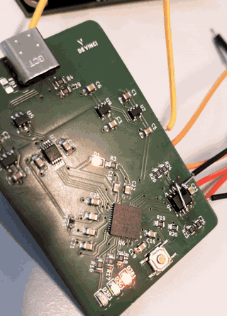
</p>

<h3>
<picture>
  <source media="(prefers-color-scheme: light)" srcset=".github/assets/h-voltera-prototype-light.svg">
  
</picture>
</h3>

In parallel, another part of the team printed the design in house with a Voltera V-One: silver conductive ink for the traces, a drilling head and rivets for the vias, then solder paste and reflow on the heated bed. A board takes about an hour, which makes it a good tool to check a routing or a footprint quickly.

<table>
  <tr>
    <td width="45%">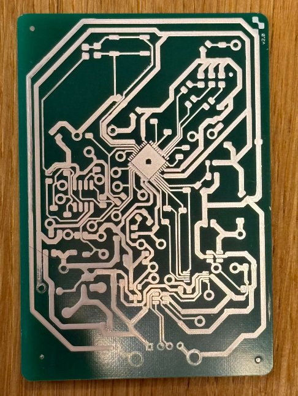</td>
    <td width="55%">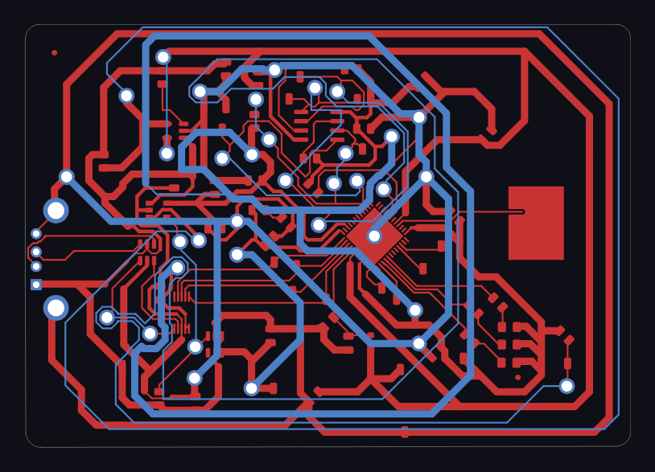</td>
  </tr>
  <tr>
    <td align="center"><sub>printed board</sub></td>
    <td align="center"><sub>layout adapted for the printer</sub></td>
  </tr>
</table>

The traces printed well, but the assembly was stopped: the cartridge and nozzle available were not the right ones for solder paste. With the 0.5 mm pitch of the FPGA, the paste deposits would also have needed careful tuning to avoid bridges. Our conclusion: very good for testing, not for producing this board.

<h3>
<picture>
  <source media="(prefers-color-scheme: light)" srcset=".github/assets/h-supply-chain-light.svg">
  
</picture>
</h3>

A security key is only as trustworthy as the way it is built, so we started documenting the software supply chain, in [`supply-chain/`](supply-chain):

- [`sbom.cdx.json`](supply-chain/sbom.cdx.json): a CycloneDX 1.6 SBOM of the `tillitis-key1` sources, generated with syft (287 components);
- [`pbom.json`](supply-chain/pbom.json): the build provenance of the CH552 firmware (source commit, `tkey-builder` toolchain image, build command, SHA-256 of the produced `.hex` and `.bin`);
- [`hashes.txt`](supply-chain/hashes.txt): the same hashes, so anyone can rebuild the firmware and compare.

Built FPGA images are **not** published here: a TKey bitstream built for SPI flash can embed the device secrets (UDS), so it should never leave the bench it was made on.

<h3>
<picture>
  <source media="(prefers-color-scheme: light)" srcset=".github/assets/h-security-proposals-light.svg">
  
</picture>
</h3>

These are proposals only. For lack of time within the project, they could not be studied in depth: none of them was implemented in firmware or tested, and the reflection would need to go further before any of them is applied.

- **Memory isolation.** We studied a published out-of-bounds read in the TKey application RAM (a time-of-check to time-of-use bug on the size of the message to sign). Tillitis fixed it in the `TK1-24.03` hardware release, which is the one we built.
- **Post-quantum signatures.** Ed25519 would not resist a large quantum computer. We proposed a hybrid scheme, Ed25519 plus ML-DSA (FIPS 204), so a signature stays valid as long as one of the two holds.
- **Flash write protection.** Routing `WP#` and `HOLD#` to the FPGA gives the firmware a way to lock the flash, which the original board does not offer. The pins are routed on our board, but no firmware uses them yet.

The redesign also has a cost for security, worth keeping in mind for a hardened version: a larger board, exposed test points and a flash in a package that is easy to probe or swap are all easier to attack than the original stick. This is fine for a lab and teaching board, not for a key carried in a pocket.

<h3>
<picture>
  <source media="(prefers-color-scheme: light)" srcset=".github/assets/h-repository-light.svg">
  
</picture>
</h3>

```
hardware/
  tk1-2layer/          final 2-layer board sent to fabrication (KiCad 9 project, libraries, 3D models, BOM)
  voltera-prototype/   last version adapted for the Voltera V-One
docs/
  schematic-2layer.pdf
  images/              photos, KiCad renders, demo GIFs
supply-chain/          SBOM, build provenance and hashes of the CH552 firmware
```

Open `hardware/tk1-2layer/tk1-0805.kicad_pro` in KiCad 9. Only the last version of each board is kept; the FPGA design and firmware are the unmodified ones from [tillitis-key1](https://github.com/tillitis/tillitis-key1).

<h3>
<picture>
  <source media="(prefers-color-scheme: light)" srcset=".github/assets/h-limits-and-next-steps-light.svg">
  
</picture>
</h3>

- The USB signal quality on 2 layers was not measured; the board works, but its margin is unknown.
- Long-term reliability and repeatability over several boards remain to be tested.
- The reproduced board is programmed through its SPI flash, the development path: it is not locked like a production key (NVCM).
- The Voltera assembly still has to be validated with the right consumables.
- The security proposals are only first ideas: time ran out before they could be studied in depth, implemented in firmware or tested. This is where the 2026-2027 LabCyber project picks up (see below).

<h3>
<picture>
  <source media="(prefers-color-scheme: light)" srcset=".github/assets/h-the-project-continues-light.svg">
  
</picture>
</h3>

Our project is presented on the LabCyber site: [Reproduction d'une clé d'authentification open hardware](https://ptcc.fr/lab-cyber/les-projets-du-labcyber/reproduction-dune-cle-dauthentification-open-hardware/).

This work goes on at the LabCyber in 2026-2027, as one of its [student projects](https://ptcc.fr/lab-cyber/les-projets-du-labcyber/projets-etudiants-au-labcyber/): *reproduction and hardening of an open hardware device for authentication or data storage*, with the TKey and WooKey-type devices as examples. It starts where we stopped: understand the device, rebuild it from its open sources, harden it (firmware, manufacturing chain, attestation), and publish the results as commons that anyone can reuse.

**About the LabCyber.** The [LabCyber](https://ptcc.fr/lab-cyber/) is a shared lab of the Campus Cyber, operated by Inria within the [PTCC](https://ptcc.fr/programme-de-transfert-au-campus-cyber/qui-sommes-nous/) (Programme de Transfert au Campus Cyber, funded by France 2030). It brings together a fab lab, a cyber range and a data hub, hosts student teams for end-of-studies projects in hardware cybersecurity, and hosted this project. Its equipment includes:

- PCB fabrication and assembly: milling machine, reflow oven, soldering and hot-air stations, PCB microscope;
- electronics analysis: oscilloscope, logic analyzer, function generator, Faraday cage, software-defined radio;
- a cyber range to simulate IT and OT systems, and a contribution to the *Studio des Communs de la cybersécurité*.

<h3>
<picture>
  <source media="(prefers-color-scheme: light)" srcset=".github/assets/h-credits-and-license-light.svg">
  
</picture>
</h3>

Team of six engineering students, mentored at the LabCyber by two members of the PTCC, including [@Acathla-fr](https://github.com/Acathla-fr), who also helped finalize the files sent to fabrication. Original TKey design by [Tillitis AB](https://github.com/tillitis/tk1-pcba).

This is a modified version of the TK1 PCB by Tillitis AB, distributed under the same licence, the **CERN Open Hardware Licence Version 2, Strongly Reciprocal**. See [LICENSE.txt](LICENSE.txt).

```
Copyright Tillitis AB 2022-2024.
Modifications copyright 2026 the Open TKey student team.
This source describes Open Hardware and is licensed under the CERN-OHL-S v2.
You may redistribute and modify this source and make products using it under
the terms of the CERN-OHL-S v2 (https://ohwr.org/cern_ohl_s_v2.txt).
This source is distributed WITHOUT ANY EXPRESS OR IMPLIED WARRANTY,
INCLUDING OF MERCHANTABILITY, SATISFACTORY QUALITY AND FITNESS FOR A
PARTICULAR PURPOSE. Please see the CERN-OHL-S v2 for applicable conditions.
Source location: https://github.com/kr-Eliza/tkey-open-hardware-reproduction
Original source location: https://github.com/tillitis/tk1-pcba
Modified in 2026: 2-layer board, 0805 passives, SOIC-8 flash, USB-C connector,
discrete LEDs, push button, flash WP#/HOLD# routed to the FPGA, replacement
regulators (see "Redesigning the PCB" above).
```
